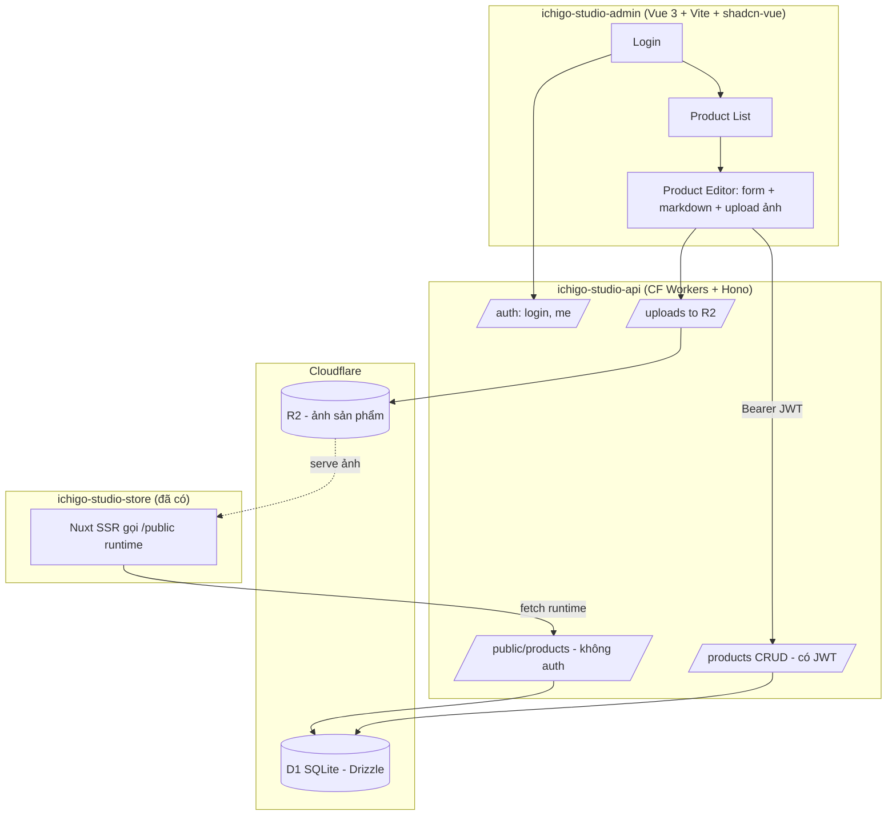

# Ichigo Studio — BE + Admin (Phase 0 & Phase 1) Design

Date: 2026-07-12
Status: Approved (design)

## Bối cảnh

Ichigo Studio hiện là storefront Nuxt 3 (SSG) trên Cloudflare Pages, sản phẩm
viết bằng Markdown qua `@nuxt/content`, catalog-only, mua hàng đổ về Messenger.
Chủ shop muốn có backend + admin để quản lý sản phẩm (và về sau: đơn hàng, tồn
kho, marketing).

## Phạm vi & phân rã

Toàn bộ nhu cầu gồm 4 hệ thống con độc lập, build theo phase, mỗi phase có
spec + plan riêng:

- **Phase 0** — Nền tảng: dựng repo BE + Admin (auth, DB, deploy).
- **Phase 1** — CMS Sản phẩm: thay việc gõ Markdown thủ công. *(spec này)*
- **Phase 2** — Đơn hàng & Khách hàng.
- **Phase 3** — Tồn kho & Sản xuất (in 3D, PLA/TPU).
- **Phase 4** — Nội dung Marketing.

Spec này chỉ bao Phase 0 + Phase 1. Các phase sau tách spec riêng.

## Quyết định kiến trúc (đã chốt)

- BE: **Cloudflare Workers + Hono + D1 (SQLite) + Drizzle ORM + R2** (ảnh).
- Admin: **Vue 3 + Vite + TypeScript + Tailwind + shadcn-vue**.
- **2 repo riêng**: `ichigo-studio-api`, `ichigo-studio-admin`.
- Storefront sẽ chuyển sang **SSR gọi API runtime** — việc này thuộc repo store,
  làm ở phase riêng, KHÔNG nằm trong spec này.
- Auth: **một tài khoản admin duy nhất** (chủ shop), email + password.

## Kiến trúc tổng thể

Ranh giới: API là nguồn dữ liệu duy nhất. Admin là client gọi API (Bearer JWT).
Store là client công khai chỉ đọc `/public/*`. Ảnh ở R2, phục vụ qua public
bucket/route riêng.

## Mô hình dữ liệu (D1 — Phase 1)

Bám sát Zod schema `content.config.ts` của store để publish không lệch.

**products**
- `id` (text, uuid, PK)
- `slug` (text, unique, not null) — kebab-case không dấu
- `title` (text, not null)
- `series` (text, not null)
- `material` (text, not null)
- `price_ref` (text) — giá tham khảo, giữ dạng chuỗi như store
- `cover` (text) — URL ảnh bìa
- `featured` (integer bool, default 0)
- `order` (integer, default 0)
- `status` (text, `draft` | `published`, default `draft`)
- `body_md` (text) — mô tả Markdown
- `created_at`, `updated_at` (integer epoch ms)

**product_images**
- `id` (text, uuid, PK)
- `product_id` (text, FK → products.id, on delete cascade)
- `url` (text, not null)
- `sort` (integer, default 0)

**users**
- `id` (text, uuid, PK)
- `email` (text, unique, not null)
- `password_hash` (text, not null) — PBKDF2 (Web Crypto; Workers không có bcrypt native)
- `created_at` (integer epoch ms)

Seed 1 user admin qua migration/seed script (email + mật khẩu ban đầu từ biến môi
trường, đổi sau).

## Auth

- `POST /auth/login`: nhận `{ email, password }`, verify PBKDF2, trả JWT HS256
  (ký bằng `hono/jwt`, secret trong Wrangler secret `JWT_SECRET`).
- Middleware `requireAuth` cho mọi route quản trị; đọc Bearer token, verify, gắn
  `userId` vào context.
- Không có đăng ký công khai — chỉ 1 admin seed sẵn.

## API surface (Phase 1)

| Method | Path | Auth | Việc |
|---|---|---|---|
| POST | `/auth/login` | ❌ | email+password → JWT |
| GET | `/auth/me` | ✅ | thông tin admin |
| GET | `/products` | ✅ | list (kèm draft), filter series/status |
| GET | `/products/:id` | ✅ | chi tiết (kèm images) |
| POST | `/products` | ✅ | tạo |
| PATCH | `/products/:id` | ✅ | sửa |
| DELETE | `/products/:id` | ✅ | xóa (cascade images) |
| POST | `/uploads` | ✅ | upload ảnh → R2, trả `{ url }` |
| GET | `/public/products` | ❌ | chỉ published (store SSR) |
| GET | `/public/products/:slug` | ❌ | chi tiết published |

- Validation: `zod` + `@hono/zod-validator`. Schema sản phẩm là nguồn chân lý.
- CORS: cho phép origin của admin và của store.
- Ảnh: `/uploads` nhận multipart, ghi vào R2 với key `products/<uuid>-<filename>`,
  trả URL công khai (public R2 bucket hoặc route `/images/:key`).

## Chia sẻ type giữa 2 repo

2 repo riêng nên KHÔNG dùng workspace. Giữ đơn giản: một file types nhỏ
(`product.ts`, `api.ts`) được copy/đồng bộ thủ công sang admin. Zod schema định
nghĩa ở API là chuẩn; admin có bản zod tương ứng cho form. Không over-engineer.

## Admin UI (Vue 3 + Vite + shadcn-vue)

- **Auth**: trang login; lưu JWT ở localStorage; route guard chuyển hướng nếu
  chưa đăng nhập; interceptor `ofetch`/axios gắn `Authorization: Bearer`.
- **Product List**: shadcn Table — cột title / series / status / featured; nút
  sửa/xóa; filter theo series & status; nút "Tạo sản phẩm".
- **Product Editor**: shadcn Form + vee-validate + zod khớp schema API; markdown
  editor cho `body_md`; upload nhiều ảnh (gọi `/uploads`, xem trước, sắp xếp);
  toggle `featured`; chọn `status` (draft/published); ô `order`.
- **State/data**: Pinia (auth state) + TanStack Query (vue-query) cho fetch/cache
  danh sách & chi tiết, invalidate sau mutation.
- **Brand**: tái dùng token màu Ichigo (`night`, `hopper`) cho quen thuộc; admin
  ưu tiên rõ ràng, mật độ thông tin cao.

## Nội dung scaffold (Phase 0, làm trước tiên)

**`ichigo-studio-api`**
- Bootstrap Hono trên Workers, `wrangler.jsonc` (D1 binding, R2 binding,
  `JWT_SECRET`).
- Drizzle schema + migration đầu tiên (3 bảng) + seed admin.
- Routes: `/auth`, `/products`, `/public`, `/uploads`.
- CORS, error handler, zod validation.
- Vitest cho logic thuần (auth hash/verify, validation, filter list).

**`ichigo-studio-admin`**
- Vite + Vue 3 + TS + Tailwind + shadcn-vue.
- Router + guard, Pinia + vue-query, API client.
- Trang: login, product list, product editor — gọi API thật.

## Ngoài phạm vi (phase sau)

- Chuyển store sang SSR + gọi `/public`.
- Đơn hàng & khách hàng (Phase 2).
- Tồn kho & sản xuất (Phase 3).
- Nội dung marketing (Phase 4).

## Testing

- API: vitest — unit cho PBKDF2 hash/verify, zod validation, list filtering;
  integration cho routes chính (login → CRUD) nếu khả thi với `unstable_dev`.
- Admin: vitest + @vue/test-utils cho component form/list; ưu tiên logic thuần.
