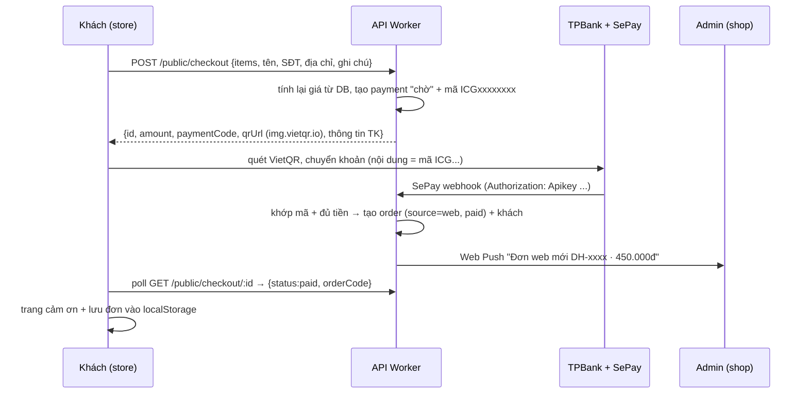

# Giỏ hàng + thanh toán chuyển khoản trên storefront — Design

> **Đổi 2026-10-23 (chủ shop chốt):** payOS **không hỗ trợ TPBank** → thay bằng **VietQR + SePay**. Khách quét VietQR chuyển thẳng vào TPBank `28262686686` của shop, nội dung là mã thanh toán `ICG` + 8 chữ số; SePay theo dõi tài khoản và gọi webhook khi có tiền vào. Các chỗ "payOS" bên dưới đã được sửa theo.

Ngày: 2026-10-23 · Repo liên quan: `ichigo-studio-store` (Nuxt SSR), `ichigo-studio-api` (Hono + D1), `ichigo-studio-admin` (Vue)

## 1. Ý định & lý do

Hiện tại khách mua hàng 100% qua Messenger: xem SP trên web → nhắn shop → shop gửi STK → khách chuyển khoản → shop soát tiền → làm + gửi hàng. Chủ shop thấy luồng này **vẫn hiệu quả** và **giữ nguyên**. Mục tiêu là **thêm một lối mua mới** cho khách thích tự đặt, không cần nhắn tin: bỏ giỏ → điền thông tin → quét VietQR chuyển khoản đủ tiền → đơn tự vào admin ở trạng thái đã thanh toán.

Thành công = khách đặt + trả tiền trên web không cần shop can thiệp; shop nhận thông báo, gọi xác nhận, xử lý đơn như mọi đơn khác trong admin.

## 2. Mục tiêu

- Nút "Thêm vào giỏ" trên trang SP (desktop + thanh dính đáy mobile) và có thể trên ProductCard.
- Giỏ hàng: xem, đổi số lượng, xóa. Không cần tài khoản.
- Checkout: form tên, SĐT (bắt buộc), địa chỉ nhận hàng (bắt buộc), ghi chú (tùy chọn).
- Thanh toán **100% tiền hàng** bằng **VietQR chuyển khoản vào TPBank của shop**; tự xác nhận qua **webhook SePay**.
- **Phí ship KHÔNG thu online** — khách trả khi nhận hàng. Ghi rõ ở giỏ, checkout và trang cảm ơn.
- Sau khi trả: đơn tạo trong bảng `orders` hiện có, `source='web'`, `paymentStatus='paid'`, `status='pending'`; shop nhận Web Push.
- Khách xem lại đơn: (1) trình duyệt tự nhớ các đơn đã đặt ("Đơn của bạn"), (2) trang **Tra cứu đơn** bằng mã đơn + SĐT.
- Tầng thanh toán (bảng `payments` + webhook) làm **dùng chung**, để tính năng "Đặt in STL" (`/in-3d`, bước P4 đang dở) nối vào sau mà không viết lại.

## 3. Ngoài phạm vi (non-goals)

- Tùy chọn SP (màu, phối màu, biến thể): khách đặt **đúng bản như ảnh**. Không có variant.
- Tài khoản khách / đăng nhập.
- Voucher / mã giảm giá trên web (voucher vẫn là admin-only, shop tự áp).
- Tính phí ship, chọn hãng vận chuyển, COD tiền hàng.
- Hoàn tiền tự động. Hủy/hoàn sau khi đã trả do shop xử lý tay (chuyển khoản lại) rồi đổi trạng thái trong admin.
- Nối trang `/in-3d` vào checkout (làm ở đợt sau, chỉ cần tầng thanh toán sẵn sàng).
- Email xác nhận.

## 4. Anti-goals (làm vậy là hỏng dù chạy được)

- Làm rối danh sách đơn của shop bằng đơn rác chưa trả tiền.
- Tin số tiền/giá gửi từ trình duyệt. Server luôn tự tính lại từ DB.
- Đánh dấu "đã thanh toán" khi webhook SePay chưa qua xác thực API key.
- Lộ thông tin cá nhân (địa chỉ, SĐT đầy đủ) qua trang tra cứu khi ai đó đoán mã đơn (mã `DH-000N` tăng dần, dễ đoán).
- Làm yếu kênh Messenger: nút "Hỏi mua" Messenger vẫn còn nguyên bên cạnh nút giỏ hàng.

## 5. Ràng buộc đã biết

- SP **in theo đơn**, không có tồn kho → không cần kiểm kho/giữ hàng.
- SP có `price = null` ("Liên hệ") **không thể bỏ giỏ**; trang SP đó chỉ hiện nút Messenger như hiện tại.
- Chỉ SP `status='published'` mới đặt được.
- Store gọi API qua **workers.dev** (lỗi CF 1042 nếu cùng zone) — xem các gọi API hiện có trong `nuxt.config` `apiBase`. Webhook SePay trỏ về API workers.dev.
- DB prod duy nhất (`yarn dev` của API chạm prod D1). Migration viết tay (drizzle-kit generate cần TTY), đánh số tiếp theo sau `0024`; kiểm tra thư mục `drizzle/` lúc làm vì có luồng song song cũng thêm migration. Migration ADD/CREATE phải áp **trước** khi deploy code.
- Copy storefront: tiếng Việt, **không dùng em-dash**, không ghi "cọc 50%" (chính sách là trả trước 100%).
- Bảng `orders` đã có: `source`, `paymentStatus` (unpaid/deposit/paid), `customerId`, snapshot `customerName/Phone`, `note`, `order_items` (snapshot title/unitPrice/qty). Mã đơn sinh bằng `nextOrderCode()` trong `routes/orders.ts`.
- Bảng `customers` có `name/phone/address/...`.
- Web Push cho admin đã có (`src/lib/push.ts`, `push_subscriptions`, quyền `chat`).
- `CLAUDE.md` của store đang ghi "catalog only: no cart, no checkout" → cập nhật khi làm xong.
- Code đặt in STL đã chuẩn bị chỗ cho thanh toán (`quote_jobs`, trạng thái `ordered` trong `schema.ts`).

## 6. Quyết định đã chốt (của chủ shop)

1. Thanh toán full 100% tiền hàng, VietQR + SePay (đổi từ payOS vì payOS không hỗ trợ TPBank).
2. Ship khách tự trả khi nhận hàng; shop gọi điện xác nhận sau khi tiền về.
3. Không có tùy chọn sản phẩm.
4. Messenger vẫn là kênh chính; giỏ hàng là kênh bổ sung.
5. Xem lại đơn = trình duyệt tự nhớ + tra cứu bằng mã đơn + SĐT.
6. Tầng thanh toán làm một lần, dùng chung với Đặt in STL; giỏ hàng làm trước.

## 7. Thiết kế (những chỗ đã quyết)

### 7.1 Luồng

### 7.2 Đơn chưa trả tiền không vào `orders` (lựa chọn của Claude)

Checkout chưa trả lưu ở bảng riêng (gọi tạm `checkouts`/`payments`), **chỉ khi SePay báo tiền về mới tạo `orders`**. Lý do: không làm rác danh sách đơn, không đốt mã `DH-` cho giỏ bỏ dở, không phải sửa mọi query/stats để loại đơn chưa trả. Checkout hết hạn sau ~15 phút (hạn hiển thị QR). Có thể đánh dấu expired lười (khi đọc) thay vì cron.

Bảng này nên **chung cho mọi nguồn thanh toán** (giỏ hàng bây giờ, `quote_jobs` sau này): có cột loại nguồn + tham chiếu, số tiền, `paymentCode` (`ICG` + 8 chữ số, duy nhất), id giao dịch SePay (duy nhất), trạng thái (pending/paid/expired/cancelled/needs_review), payload giỏ + thông tin khách đã snapshot, `orderId` khi đã tạo đơn.

### 7.3 Xác nhận thanh toán (SePay)

- Webhook SePay xác thực bằng header `Authorization: Apikey <SEPAY_WEBHOOK_KEY>`; trả 200 `{"success": true}` (SePay retry tối đa 7 lần nếu khác). Chống trùng bằng `id` giao dịch SePay (UNIQUE).
- SePay gửi **mọi** giao dịch tiền vào tài khoản, kể cả khách Messenger chuyển bình thường → giao dịch **không có mã `ICG…`** bị bỏ qua im lặng.
- Mã lấy từ trường `code` của SePay (cấu hình mẫu: tiền tố `ICG`, hậu tố số 6–8) hoặc tìm trong `content` (không phân biệt hoa thường).
- Khớp mã + đúng số tiền → tạo đơn. Tiền về cho checkout **đã hết hạn** (QR hiển thị 15 phút): vẫn tạo đơn.
- **Tiền về nhưng không khớp** (đúng mã nhưng lệch số tiền, hoặc có dạng mã `ICG…` mà không trỏ tới checkout nào), *lựa chọn của Claude*: **không tạo đơn**, ghi `needs_review` + Web Push "Có khoản thanh toán cần kiểm tra". Shop xử lý tay. Không làm màn hình đối soát riêng ở đợt này.
- Không gọi API SePay để đối soát (dựa vào webhook + retry); trang chờ của khách chỉ poll DB của mình.
- Cấu hình: secret `SEPAY_WEBHOOK_KEY` + biến ngân hàng (`BANK_BIN 970423`, `BANK_ACCOUNT`, `BANK_ACCOUNT_NAME`). Thiếu → checkout trả 503, store ẩn giỏ.

### 7.4 Tạo đơn khi đã trả

- Khớp khách theo SĐT (chuẩn hóa) với `customers`; không có thì tạo mới (name, phone, address). Có thì không ghi đè dữ liệu cũ của khách; địa chỉ giao của đơn lưu ở đơn (snapshot) — builder chọn chỗ lưu (cột mới hoặc `note`).
- `orders`: `source='web'`, `paymentStatus='paid'`, `status='pending'`, `deposit` = 0, tổng = Σ giá × qty, ghi chú khách vào `note`. `order_items` snapshot như đơn admin.
- Gửi Web Push tới các thiết bị admin đã bật chuông (tái dùng `push.ts`; người nhận = user có quyền `orders` hoặc toàn bộ subscription, builder chọn).
- Admin: đơn web hiện trong danh sách như đơn thường, có nhãn nguồn "Web" và thể hiện rõ đã trả bằng chuyển khoản (mã thanh toán + mã giao dịch ngân hàng ở chi tiết đơn).

### 7.5 Storefront

- **Giỏ** lưu ở localStorage (chỉ `productId` + `qty`; giá/tên/ảnh lấy lại từ `/public/products` khi hiển thị). SP không còn published hoặc mất giá → đánh dấu "không còn bán" trong giỏ, không cho đặt.
- Icon giỏ + số lượng ở `AppHeader`. Trang/ngăn giỏ, trang checkout (form + tóm tắt), trang chờ thanh toán (QR + đếm ngược + nút mở app ngân hàng qua `checkoutUrl`), trang cảm ơn (mã đơn, "shop sẽ gọi xác nhận", "phí ship trả khi nhận").
- Tất cả trang giỏ/checkout/tra cứu: `noindex`, không vào sitemap.
- GA4: bắn event chuẩn ecommerce (`add_to_cart`, `begin_checkout`, `purchase`) bên cạnh `generate_lead` hiện có.
- Validate SĐT Việt Nam ở cả client và server.

### 7.6 Xem lại đơn

- **Trình duyệt nhớ:** sau khi trả, lưu `{orderCode, phone}` (hoặc token tra cứu) vào localStorage; mục "Đơn của bạn" liệt kê và mở trang chi tiết.
- **Tra cứu:** trang nhập mã đơn + SĐT → API `POST /public/orders/lookup` trả: mã đơn, ngày, món + số lượng + tổng, trạng thái (nhãn thân thiện cho khách), hãng + mã vận đơn nếu có. **Không** trả địa chỉ đầy đủ/SĐT đầy đủ. Có giới hạn tần suất theo IP để chống dò mã.
- Chỉ đơn `source='web'`? → Không bắt buộc; tra cứu áp cho mọi đơn khớp mã + SĐT (đơn Messenger có SĐT cũng tra được). Builder có thể giữ đơn giản.

### 7.7 Kiểm thử thanh toán thật (chủ shop chốt)

Không có staging → **test thẳng trên prod bằng chuyển khoản thật số tiền nhỏ** (SePay có Test mode để giả giao dịch trước, tùy chọn):

- Một SP test giá thấp (ví dụ 2.000đ) **chỉ đặt được qua link bí mật**, không hiện ở danh sách, sitemap hay tìm kiếm.
- Đơn sinh từ SP test (hoặc checkout có cờ test) được đánh dấu **"đơn test"** trên `orders` và **bị loại khỏi mọi thống kê** (doanh thu, top khách, SP bán chạy, phân tích AI). Admin có thể lọc/ẩn đơn test.
- Go-live: chỉ bật nút giỏ hàng cho khách sau khi chủ shop đã test thành công end-to-end (có cờ bật/tắt tính năng trong settings, tắt thì store ẩn giỏ).

## 8. Để builder quyết

- Tên bảng/cột cụ thể, cách chia route (`/public/checkout`, `/sepay/webhook`...).
- Giỏ là trang riêng hay drawer; layout UI theo design hiện có của store (dark, accent hopper).
- Cách trình bày QR + thông tin chuyển khoản (ảnh `img.vietqr.io` như hóa đơn admin).
- Giới hạn qty mỗi món (gợi ý tối đa ~10) và số món mỗi giỏ.
- Cơ chế rate-limit (KV/D1 đếm theo IP hoặc Cloudflare rule).
- Thứ tự phase triển khai và test (API trước: bảng + lib SePay + webhook có test; rồi store; rồi admin nhãn nguồn).

## 9. Việc cần chủ shop làm

- Tạo tài khoản SePay, liên kết TPBank `28262686686`.
- Trên my.sepay.vn: tạo mẫu mã thanh toán (tiền tố `ICG`, hậu tố số 6–8) và webhook "Có tiền vào" trỏ về URL builder đưa, xác thực API Key.
- Bật chuông thông báo trong admin trên điện thoại (iOS phải cài PWA admin).
